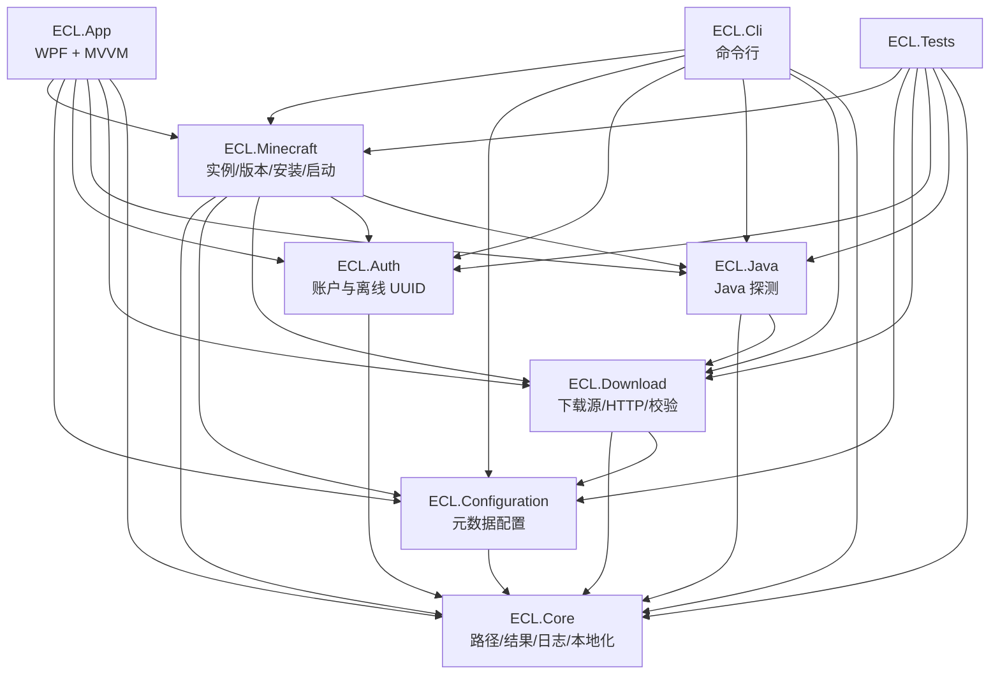

# 架构总览

## 1. 目标

ECL 是一个 Windows 优先的 Minecraft 启动器，目标能力对齐 HMCL / PCL2：

- 原版与多加载器安装、实例隔离、Java 管理。
- 微软登录、离线账户、第三方认证。
- Mod / 整合包 / 资源包 / 光影管理。
- 稳定、可诊断、可扩展的启动与更新链路。

同时保留自己的设计空间：配置项由元数据驱动、启动流程分阶段可观测、模块边界清晰、UI 只是薄壳。

当前版本（v0.8）已完成原版安装、Java 管理与加载器安装：版本/资源/库/日志下载、natives 解压、EULA、逐实例 Java 选择、兼容性检查、Mojang/Adoptium/Zulu/Liberica Java 运行时下载、Fabric（含 Fabric API）、Forge/NeoForge（含安装器 processors）与 Cleanroom 安装、OptiFine 显式安装；Mod/整合包/资源包管理、CurseForge 与 Modrinth 搜索/远程下载、崩溃分析、脱敏诊断包、下载暂停/速度与自定义 JVM 预设也已接入。UI 在 v0.8 完成 launcher-first 重构：主页只负责启动与版本情报，所有下载集中到「下载」页。v0.3 账户体系因 Microsoft OAuth 审核限制暂缓；首次启动向导本阶段暂缓。

## 2. 设计原则

1. **模块化单体**：一个进程、一个发布物，但按职责拆项目；避免过早微服务化。
2. **UI 薄、逻辑厚**：业务逻辑不依赖 WPF，可在 CLI 和单元测试中复用。
3. **元数据优先**：配置项、可见性、校验、作用域都声明在定义里，UI 与 CLI 从定义生成。
4. **显式失败**：可预期失败用 `Result` / `LaunchReport` 表达，错误带稳定 Code；异常只用于意外情况。
5. **可观测**：每个启动步骤都有状态、耗时和消息，日志同时写文件与调试输出。
6. **公开仓库不依赖私有仓库**：源码、文档、构建全部在 public；私有仓库只放签名证书与凭据。
7. **先正确再完整**：当前未实现的链路明确返回“未实现”，不伪装成功。

## 3. 模块与依赖



依赖方向始终从“外壳”指向“能力”，模块之间不允许反向依赖 UI。

## 4. 项目职责

| 项目 | 职责 | 关键类型 |
| --- | --- | --- |
| `ECL.Core` | 应用路径、`Result`、JSON 约定、Serilog 配置、JSON 本地化 | `IAppPaths`, `Result<T>`, `EclJson`, `JsonLocalizer` |
| `ECL.Configuration` | 配置定义、注册表、全局/实例作用域、持久化、可见性 | `OptionDefinition<T>`, `OptionRegistry`, `ISettingsService` |
| `ECL.Download` | 下载源策略、官方↔BMCLAPI 映射、并发/重试/续传、哈希校验 | `DownloadSourceResolver`, `IDownloadService`, `DownloadRequest` |
| `ECL.Auth` | 账户模型、离线 UUID、账户文件 | `Account`, `IAccountService`, `OfflineUuid` |
| `ECL.Java` | Java 版本解析、运行时探测、需求/兼容性/32-64 位与内存校验、JVM 预设、Mojang/Adoptium/Zulu/Liberica 下载与解压 | `JavaVersion`, `IJavaLocator`, `JavaRequirement`, `JvmPresets`, `IJavaInstallService` |
| `ECL.Minecraft` | 实例存储、版本 JSON/继承、原版/加载器安装、加载器目录、Java 选择、启动上下文与步骤、进程启动、Mod/整合包/资源包管理、CurseForge/Modrinth API、统一搜索与下载、版本情报 | `GameInstance`, `VanillaInstallService`, `ILoaderCatalog`, `IJavaSelectionService`, `IModService`, `IModpackService`, `ICurseForgeClient`, `ICurseForgeService`, `IModrinthClient`, `IContentSearchService`, `IContentInstallService`, `IVersionNewsService`, `ILaunchStep` |
| `ECL.App` | WPF 外壳、MVVM、主题、页面、对话框 | `MainViewModel`, `HomeViewModel`, `DownloadViewModel`, `InstancesViewModel`, `ModsViewModel`, `SettingsViewModel` |
| `ECL.Cli` | 无 GUI 管理、调试启动链路 | `CliApplication`, `ParsedCommandLine` |
| `ECL.Tests` | 单元测试与临时数据目录 | `TestEnvironment`, `FakeProcessLauncher` |

## 5. 组合根与生命周期

App 与 CLI 各自在入口建立 DI 容器，但使用同一组模块扩展方法：

```csharp
services.AddEclLogging(paths, console: false);
services.AddEclCore(paths, culture);
services.AddEclConfiguration();
services.AddEclDownload();
services.AddEclAuth();
services.AddEclJava();
services.AddEclMinecraft();
```

- 配置注册表在首次解析时聚合所有 `IOptionProvider`，因此新模块可以在自己的 `Add...` 中追加选项。
- 启动步骤通过 `IEnumerable<ILaunchStep>` 注入并按 `Order` 排序，新增步骤不需要改启动器。
- App 启动顺序：创建 `AppPaths` → 读取语言与实例下载位置 → 建立本地化器 → 构建容器 → 显示主窗口 → 异步加载实例、设置与版本情报。
- 语言切换标记为“需要重启”，XAML 中的静态文本由 `LocExtension` 在加载时解析。

## 6. 数据目录

数据目录默认 `%LOCALAPPDATA%\EnderCraftLauncher`，可通过以下优先级覆盖：显式 `--data-dir`（CLI）→ 环境变量 `ECL_DATA_DIR` → 可执行文件旁存在 `portable.flag`（`<程序目录>/data`）→ 用户本地数据目录。

“实例下载位置（.minecraft 目录）”是独立的 `<game>` 根目录，由全局设置 `launcher.minecraftDirectory` 控制（环境变量 `ECL_GAME_DIR` 可覆盖），默认等于数据目录。修改后需要重启；版本隔离始终开启，每个实例在 `<game>/instances/<id>/minecraft` 拥有独立游戏目录。

```text
<data>/                            # 启动器数据（配置、账户、日志、下载缓存）
├─ config/
│  ├─ global.json                  # 全局配置
│  └─ eula.json                    # EULA 同意记录
├─ accounts/
│  └─ accounts.json                # 账户与默认账户
├─ downloads/                      # 无实例时的文件下载目录
│  ├─ mods/  resourcepacks/  shaderpacks/  datapacks/  modpacks/
├─ java/                           # 启动器托管的 Java 运行时
├─ cache/                          # Cleanroom/Java/Forge 安装缓存
└─ logs/                           # ecl-YYYYMMDD.log 与 install/ 安装失败诊断

<game>/                            # 实例下载位置（.minecraft 目录）
├─ instances/
│  └─ <instance-id>/
│     ├─ instance.json             # 实例元数据（含加载器、组件版本、versionIsolation=true）
│     ├─ settings.json             # 实例作用域配置（按需创建）
│     ├─ logs/
│     └─ minecraft/                # 版本隔离后的游戏工作目录
│        ├─ mods/                  # *.jar 启用，*.jar.disabled 禁用
│        ├─ config/
│        ├─ saves/
│        ├─ resourcepacks/
│        ├─ shaderpacks/
│        ├─ datapacks/
│        ├─ logs/
│        ├─ natives/
│        └─ .ecl-modpack.json      # 整合包导入标记（按需创建）
├─ versions/<version-id>/          # 共享版本 JSON 与 jar
├─ libraries/                      # 共享 Maven 库
└─ assets/                         # 共享资源
```

实例 ID 采用 `slug-6位十六进制` 形式（例如 `survival-a1b2c3`），只允许小写字母、数字、点、下划线、连字符，避免路径穿越；显示名称与目录名解耦。

## 7. 核心流程

### 7.1 创建实例

1. UI/CLI 校验名称与版本格式。
2. `InstanceService` 生成唯一 ID 与 `VersionId`（加载器会追加后缀）。
3. `FileSystemInstanceStore` 创建目录、游戏子目录并原子写入 `instance.json`。
4. 实例作用域配置通过 `settings.json` 按需写入，未设置时继承全局。

### 7.2 安装原版版本

1. 按下载源策略获取版本清单（官方 / BMCLAPI 镜像候选）。
2. 找到实例对应的版本条目，下载版本 JSON；若存在 `inheritsFrom`，递归下载父版本并合并。
3. 下载 client jar、按当前 OS/架构与 rules 过滤后的依赖库（含 natives classifier）、资源索引、资源对象、日志配置。
4. SHA-1 校验；已存在且校验通过的文件直接跳过；失败文件自动尝试下一候选源。
5. natives 不在安装阶段解压，而是每次启动前解压到实例的 `minecraft/natives`，保证实例隔离。

### 7.3 启动实例

详见 [launch-pipeline.md](launch-pipeline.md)。概要：

```text
Validate(100) → ResolveVersion(150) → ResolveJava(200) → CheckFiles(350)
→ ExtractNatives(360) → EnsureEula(370) → BuildCommand(400) → Start(500)
```

- Dry Run 只生成命令，不启动进程；缺少版本文件时降级为警告。
- 真实启动缺少 Java、关键文件或 EULA 同意时直接失败，并停在对应步骤。
- 每个步骤返回 `Success / Warning / Skipped / Failed`，UI 与 CLI 展示同一份报告。

### 7.4 Java 管理

1. 读取版本 JSON 的 `javaVersion`（权威来源）；缺失时按游戏版本推断最低主版本（1.16 及以下建议 Java 8，26.x 建议 Java 25）。
2. 按“实例指定 → 全局指定 → 自动选择 → 最高版本兜底”的顺序解析 Java。
3. `JavaCompatibility` 只判断“低于最低版本 / 未知 / 兼容”，不限制最高版本；UI 弹窗提示，实例可关闭检查。
4. 没有可用 Java 时，`IJavaInstallService` 从 Mojang Java 运行时索引下载对应 component 到 `<data>/java/<component>`，校验 SHA-1，处理目录、符号链接与执行位。

详见 [java.md](java.md)。

### 7.5 加载器与组件

1. `ILoaderCatalog` 统一读取 Fabric Loader、Forge、NeoForge、Cleanroom、Fabric API、OptiFine 的可用版本，并附带能获取到的更新时间。
2. Fabric 使用 Meta 的 profile JSON 生成版本 JSON；Cleanroom 从官方安装器 zip 提取 `version.json` 并补全仓库 URL，不执行安装器进程。
3. Forge/NeoForge 从官方安装器读取 `install_profile.json` 与 `version.json`；spec 0 直接使用版本 JSON，spec 1+ 在下载原版/加载器文件后由 `ForgeProcessorRunner` 运行安装器 processors，产出打补丁的客户端 jar。
4. Fabric 实例强制安装 Fabric API；OptiFine 仅在用户显式选择且加载器为 Forge 或 Cleanroom 时下载到实例 `mods/`。
5. 启动时补充 Fabric 的 `arguments.jvm`、Forge/NeoForge 的 `${library_directory}`/`--launchTarget` 与 Cleanroom 旧式 `--tweakClass`；版本 ID 形如 `<游戏版本>-<加载器>-<加载器版本>`。

详见 [loaders.md](loaders.md)、[ADR 0007](adr/0007-loaders-and-components.md) 与 [ADR 0008](adr/0008-forge-neoforge-installers.md)。

### 7.6 配置解析

详见 [configuration.md](configuration.md)。概要：

- 全局选项只看 `config/global.json`。
- 实例选项只看 `instances/<id>/settings.json`；空值表示继承或未设置。
- 每次读取返回“值 + 来源（Default/Global/Instance）”，UI 用来源标记帮助用户理解覆盖关系。

### 7.7 CurseForge

详见 [curseforge.md](curseforge.md)。概要：

1. 所有 CurseForge API 请求都发往 ECL 自建的代理（客户端路径与官方 API 一致，`/v1/...`），由代理注入 `x-api-key` 后转发到 `api.curseforge.com`。代理的源码、路由与部署材料不在本仓库。ECL 不读取、不发送也不嵌入 key，构建过程不注入任何凭据。
2. 代理只转发 API；`edge.forgecdn.net` 等实际文件下载仍由 ECL 直接访问。
3. `CurseForgeClient` 负责搜索、项目/文件解析、批量文件查询、下载 URL、限流重试；不做磁盘缓存；只接受 CurseForge CDN 下载地址。
4. `CurseForgeService` 按实例游戏版本/加载器选择文件，递归安装必需依赖，写入 `minecraft/.ecl-curseforge.json`。
5. `ModpackService` 对 CurseForge `.zip` 批量解析 `manifest.json` 的 `files[]`，下载、校验、解压 overrides，并写入 `.ecl-modpack.json`。
6. WPF 与 CLI 只调用 `ICurseForgeService` / `ICurseForgeClient`，不直接拼 HTTP。

### 7.8 Modrinth 与统一下载

1. `ModrinthClient` 访问 `https://api.modrinth.com/v2`，只负责搜索、项目/版本、依赖与文件 URL；只接受 `modrinth.com` / `*.modrinth.com` 的 HTTPS 文件地址。
2. `ContentSearchService` 把 CurseForge 与 Modrinth 的结果映射为统一的 `ContentHit`；来源过滤支持「全部 / 仅 CurseForge / 仅 Modrinth」，「全部」下两个平台并行请求并交错排列，不跨平台去重。
3. `ContentInstallService` 统一执行安装/下载：资源包、光影包、数据包按类型落入实例或 `<data>/downloads`；Modrinth Mod 递归补齐必需依赖；CurseForge Mod 复用 `CurseForgeService` 的依赖逻辑。
4. 整合包无论来源先下载为归档（`.mrpack` / CurseForge `.zip`），再交给 `IModpackService` 导入；没有实例时可仅下载，或由 `ModpackArchiveInspector` 读取包内 `dependencies`/`manifest.json` 自动创建实例后导入。
5. `MojangVersionNewsService` 读取 Mojang 版本清单，为「主页 → 新版本情报」提供数据；主页不承载任何下载动作。

## 8. 横切关注点

### 错误模型

- 可预期失败：`Result` / `Result<T>`，带稳定 `Code`（如 `instance.duplicate_name`）。
- 启动失败：`LaunchReport.Success = false`，失败步骤带用户可读消息。
- 意外异常：记录日志；UI 线程异常由 `DispatcherUnhandledException` 兜底。

### 日志

- Serilog：文件按天滚动，保留 14 天；Debug 级别。
- CLI 控制台只显示 Warning 及以上；UI 不输出控制台。
- 日志中不写入访问令牌、刷新令牌、证书密码。

### 本地化

- 语言文件为嵌入式 JSON：`src/ECL.Core/Localization/Locales/*.json`。
- 支持 `zh-CN`、`en-US`；未知语言回退 `en-US`，缺失键回退键名。
- UI 动态文本通过 `ILocalizer`；XAML 静态文本通过 `LocExtension`。
- 语言选项需要重启生效，避免运行时重建整棵可视树。

### 线程与取消

- 业务方法尽量异步并支持 `CancellationToken`。
- 库代码使用 `ConfigureAwait(false)`；UI 层回到 UI 线程更新集合。
- 设置写入是小文件同步原子写，当前不引入异步队列。

### 安全

- 更新包与安装包必须签名验证（规划中）。
- 账户令牌计划使用 DPAPI 加密（规划中），当前仅实现离线账户。
- 签名证书、私钥、OAuth 机密只存在于 private Core 仓库；public 仓库构建不读取它。
- CurseForge API key 只保存在私有代理服务端；ECL 客户端、构建产物、日志与诊断包都不含 key。代理实现与部署材料只在 private Core 仓库。
- CurseForge 下载只接受官方 CDN（`*.forgecdn.net` / `*.curseforge.com`）；Modrinth 只接受 `modrinth.com` / `*.modrinth.com` 的 HTTPS 地址，避免 API 响应被滥用为任意 URL。

### 测试

- `TestEnvironment` 为每个测试创建独立临时数据目录。
- `FakeProcessLauncher` 验证启动命令而不真的拉起 Java。
- WPF 项目可在 Linux 上交叉编译（`EnableWindowsTargeting`），但 UI 行为需在 Windows 验证。

## 9. 扩展点

### 新增配置项

1. 在 `LauncherOptionsProvider` 或模块自己的 `IOptionProvider` 中声明 `OptionDefinition<T>`。
2. 补充本地化键（名称、描述、选项值、单位）。
3. UI 自动生成控件；CLI 自动出现在 `settings list`。
4. 若需要校验，使用 `Min/Max/Choices/Validate`；若需要联动，使用 `VisibleWhenKey/Value`。

### 新增启动步骤

1. 实现 `ILaunchStep`，设置 `Id` 与 `Order`。
2. 在 `AddEclMinecraft` 中注册。
3. 在步骤内读写 `LaunchContext`，返回 `LaunchStepResult`。
4. 补充本地化键 `launch.step.<id>` 与该步骤的消息。

### 新增模块

1. 新建 `src/ECL.Xxx`，目标 `net10.0`，依赖 `ECL.Core`。
2. 提供 `AddEclXxx` 扩展方法与公开服务接口。
3. 在 App/CLI 组合根注册；测试中按需注册。
4. 在 `docs/architecture.md` 更新依赖图与职责表。

### 新增 UI 页面

1. 新建 ViewModel（继承 `ObservableObject`）。
2. 新建 UserControl，并在 `App.xaml` 添加 `DataTemplate` 映射。
3. 在 `MainViewModel.NavItems` 中添加入口。

## 10. 当前边界与已知缺口

- 已实现原版安装、资源/库补全、natives 解压、EULA、Java 选择/兼容性检查/Mojang 运行时下载；Fabric/Forge/NeoForge/Cleanroom 安装已完成。
- Fabric/Forge/NeoForge 生成的继承链已按 `inheritsFrom` 合并；Forge/NeoForge 的 processors 产物（client jar）位于共享 `libraries/`。
- 已处理 library `rules`、natives classifier、日志配置路径；已使用版本 JSON 的 `arguments.jvm` 与加载器专属 `arguments.game` 参数（标准游戏参数仍由启动器生成）。
- Java 自动下载支持 Mojang、Adoptium、Zulu 与 Liberica；32/64 位与内存提示、JVM 预设已接入。
- 未实现 Microsoft OAuth、authlib-injector、令牌加密（v0.3 暂缓）。
- 未实现更新器与签名验证；签名脚本已预留。
- 未实现下载限速；并发、重试、续传、暂停/恢复已生效。
- 界面固定为 ECL 深色主题（浅色模式已移除），内嵌 HarmonyOS Sans SC 字体；主题刷子统一使用 `DynamicResource`，避免样式解析时捕获旧颜色。托盘、完整 i18n 热切换与更细的无障碍仍在路线图中。
- 崩溃分析基于日志/崩溃报告文本与 Mod 元数据排序，不是完整的符号化解析；日志导出已做脱敏。
- CurseForge 与 Modrinth 的搜索、一键安装、整合包远程下载与 `.mrpack` 自动建实例导入已完成；不做 Mod 更新检查、可选依赖选择，作者禁止第三方分发或无 CDN 地址的文件无法下载。
- 实例下载位置（.minecraft 目录）修改后需要重启，已有实例不会自动迁移。
- 下载页当前为单页结果（PageSize=40），分页与无限滚动仍在路线图中。
- 资源包/光影包以 `options.txt` 为启用状态唯一事实来源，支持启用/禁用、缺失/重复/未识别条目提示与原子写入；独立配置文件的 shader 实现不会被同步。
- 首次启动向导本阶段暂缓。

## 11. 下一步

按 [roadmap.md](roadmap.md) 推进：v0.7 主题、崩溃分析、诊断包、下载控制、自定义 JVM 预设与资源包/光影包启用状态已完成，CurseForge 搜索/安装与远程下载已补全；下一步完成 Mod 依赖匹配与更新检查设计、无障碍细节和 v1.0 分发/更新。
