# ECL Roadmap

> **路线图以图为主、任务为单位。** 按图中箭头推进；每一步都有可交付结果和验收条件。没有通过验收，不得仅凭代码已提交标记完成。

状态：`[x]` 已完成（有实现与验证依据）；`[~]` 进行中；`[ ]` 待开始；`[!]` 外部阻塞；`[-]` 暂不计划。

## 当前路线图

```mermaid
flowchart TD
    A["当前基线<br/>多实例 / 多加载器 / Java / Microsoft + Yggdrasil<br/>整合包与内容管理 / CLI / WPF / CI"] --> B

    subgraph P1["P1 · 实例管理可靠性（当前优先）"]
      B["1.1 导入实例回归<br/>自动化回归已建立；实机验收待补"] --> C["1.2 目录与文件所有权<br/>扫描、启动、内容操作、诊断、删除"]
      C --> D["1.3 实例迁移<br/>更换游戏目录，安全搬迁与回滚"]
      D --> E["1.4 实例配置变更<br/>核心服务已有；UI / 完整回归待补"]
    end

    subgraph P2["P2 · 内容生命周期"]
      F["2.1 Mod 更新检查<br/>版本范围与兼容性判断"] --> G["2.2 更新预览与批量更新<br/>依赖选择、校验、取消、回滚"]
      G --> H["2.3 整合包更新<br/>文件差异预览、冲突处理、恢复"]
      H --> I["2.4 下载中心完善<br/>分页、分类、排序、筛选"]
    end

    subgraph P3["P3 · 日常使用体验"]
      J["3.1 账户中心<br/>注销、失效重认证、账户切换"] --> K["3.2 实例工作区收尾<br/>设置作用域、操作反馈、空状态"]
      K --> L["3.3 可访问性与诊断<br/>键盘、焦点、错误代码、日志"]
      L --> M["3.4 备份与恢复<br/>实例备份、校验、还原"]
    end

    subgraph P4["P4 · 可分发版本"]
      N["4.1 安装包方案与构建"] --> O["4.2 签名与更新协议"]
      O --> Q["4.3 安装 / 升级 / 卸载测试"]
      Q --> R["4.4 v1.0 发布"]
    end

    E --> F
    I --> J
    M --> N

    S["已完成基线<br/>导入现有安装 / 独立实例工作区 / ICO<br/>Authlib-Injector 实机闭环 / 安全加固"] -.-> A

    classDef done fill:#dcfce7,stroke:#16a34a,color:#14532d
    classDef active fill:#fef3c7,stroke:#d97706,color:#78350f
    classDef todo fill:#f1f5f9,stroke:#64748b,color:#0f172a
    class A,S done
    class B active
    class C active
    class D,E,F,G,H,I,J,K,L,M,N,O,Q,R todo
```

**推进规则：** P1 完成并通过回归后进入 P2；P2 完成后进入 P3；P3 的备份恢复能力稳定后进入 P4。安全修复和回归测试可随时插队，不得为了赶阶段跳过。图中状态以当前可核验的实现和验证记录为准；历史 CI 不得作为当前 HEAD 的通过证明。

---

## 已完成基线

- [x] 原版、Fabric、Forge、NeoForge、Cleanroom 安装与启动。
- [x] Java 探测、兼容性检查、运行时安装与实例级选择。
- [x] Microsoft OAuth / Xbox / XSTS / Minecraft Services 登录、DPAPI 凭据保护与静默刷新；完成真实 Windows 实机验证。
- [x] Authlib-Injector / Yggdrasil：服务器管理、登录、令牌刷新、启动注入；已完成真实服务器登录、启动游戏并加入第三方认证服务器的实机闭环。
- [x] 第三方认证 HTTPS 限制、重定向拒绝、服务器地址变更验证、Injector 下载哈希校验与缓存路径防护。
- [x] Modrinth / CurseForge 搜索、安装；mrpack / CurseForge ZIP 导入与 mrpack 导出。
- [x] Mod、资源包、光影包、数据包管理；崩溃分析与脱敏诊断包。
- [x] 实例库与实例工作区分离；实例库负责展示和入口，工作区承载实例操作。
- [x] 实例创建从 Mojang 版本清单选择游戏版本，支持正式版 / 快照版 / 愚人节版筛选（默认正式版）；内容管理、账户、Java/JVM、内存覆盖与模组依赖处理集中在工作区，不再提供独立“内容”页面。
- [x] 模组缺失依赖：`DependencyResolver` 先把 mod id 解析为带来源/项目/版本/文件信息的 `ResolvedDependencyGraph`，再直接安装已解析文件；区分未找到、歧义、不兼容与解析失败，无法精确匹配时只提示手动搜索。
- [x] 扫描并导入已有 Minecraft 安装，支持共享游戏目录与版本隔离目录；导入不复制原文件（自动化回归已建立，实机验收状态见 P1 1.1）。
- [x] 导入实例的启动、Mod、资源包、光影、崩溃报告、诊断与内容安装使用实例实际游戏目录（由自动化回归覆盖；真实安装验收仍需单独记录）。
- [x] CLI、WPF、Core 单元测试与 Windows / Linux CI。
- [x] Windows EXE 与主窗口使用项目 ICO 图标。
- [x] 统一任务中心：下载批次、Minecraft 安装、整合包导入、内容安装/下载、CurseForge Mod 安装与 Java 运行时下载均已接入 Operation；包含阶段、字节/项目进度、平滑速度/ETA、停滞/重试/失败归因、当前/最近任务条、取消与失败重试、诊断详情，WPF 与 CLI 共用同一份任务快照；备份/恢复、整合包导出、启动与实例迁移/删除尚未接入。

> 以上是已落地能力，不代表所有边界条件已经覆盖。导入实例自动化回归已建立，但当前记录中的 CI 属于历史提交；真实既有安装的手工验收与当前基线复验仍需补齐。

## P1 · 实例管理可靠性

### 1.1 导入实例回归（自动化覆盖完成，实机验收待完成）

- [x] 建立测试样本：原版共享目录、Fabric/Forge 隔离目录、缺失可选文件、损坏/不完整版本 JSON。
- [x] 验证扫描结果：只识别有效版本目录；重复扫描不产生重复实例。
- [x] 验证导入：不复制、不移动、不修改原安装文件；重复导入有明确处理方式。
- [x] 验证启动：版本继承、libraries、assets、logging 配置缺失时能给出正确结果与诊断。
- [x] 验证导入实例的 Mod / 资源包 / 光影 / 崩溃报告 / 诊断路径均指向实际游戏目录。

**当前状态：** 自动化测试样本与回归用例已建立；历史 CI 通过，但当前 HEAD 尚未重新验证，真实既有安装的手工验收也未见记录。整体验收暂不标记完成。

**交付物：** 一组可重复运行的导入实例回归测试与测试样本说明。

**验收：** 导入前后原目录文件哈希不变；共享目录和隔离目录均能正确启动或明确报告缺失条件；当前目标提交的 Windows CI 通过；至少使用一份真实既有安装完成导入与启动验收，并记录环境和结果。

**历史验证记录（2026-10-31，非当前 HEAD 的 CI 声明）：** 样本与覆盖说明见 [instance-import.md](instance-import.md)。当时在 Windows 本地执行 `tests/ECL.Tests/Minecraft/ImportRegressionTests.cs` 所属测试套件，296 项通过；[CI run #163](https://github.com/hellokug2699/Ender-Craft-Launcher/actions/runs/41182107585) 对提交 `c505cde` 的 Windows 构建、格式检查、测试与 Linux 测试显示 `completed` / `success`。该记录只证明当时对应提交的结果，不代表当前分支 HEAD 已重新验证。本次修复的缺陷包括：加载器版本缺少自己的 client jar 时类路径错误、损坏/不完整版本 JSON 仍可导入且启动失败缺少原因、多层继承时 GameVersion 被写成加载器配置名。

### 1.2 目录与文件所有权（当前优先）

- [x] 明确区分 ECL 管理目录、实例游戏目录、共享目录和外部启动器管理的文件。
- [x] 明确删除语义：区分仅移除启动器记录、删除 ECL 托管实例数据；删除前展示将删除的目录与数据类型。
- [x] 检查实例删除：不得删除仍被其他实例引用的共享游戏目录；对存档、配置等用户数据提供明确保留/删除选择。
- [x] 检查内容删除 / 禁用：只能操作目标实例实际拥有或明确管理的文件。
- [x] 多个实例引用同一游戏目录时，展示引用关系、引用来源与影响范围，并阻止危险的重复操作。
- [x] 对路径失效、目录被外部移动、权限不足提供可恢复提示。

**当前状态：** 删除边界与内容操作路径约束均已实现并通过自动化回归：`InstanceDeletionPlanner` 生成结构化删除计划，区分 ECL 托管、外部与共享目录；`InstanceDeleteOptions` 提供“仅移除记录 / 删除 ECL 托管数据”两种模式；外部与共享目录在任何模式下都不会被递归删除。WPF 与 CLI 都会先展示计划，CLI 支持 `--dry-run` / `--json` / `--keep-data`。内容删除/禁用只接受实例游戏目录内的合法文件名，拒绝路径穿越与绝对路径。WPF 删除对话框和真实共享 `.minecraft` 目录仍需人工实机验收，因此整体不标记为完全完成。

**交付物：** 目录所有权规则、共享目录引用检查和删除保护。

**验收：** 删除前能准确预览影响；仅移除记录不会删除用户游戏目录、存档或其他实例仍在使用的文件；选择删除托管数据时只删除明确列出的 ECL 所有文件。覆盖自建实例、导入共享目录、多个实例引用同一目录、路径失效和取消删除。

**验证（2026-10-31，本地）：** `tests/ECL.Tests/Minecraft/InstanceDeletionTests.cs` 覆盖自建实例计划与两种删除模式、外部目录保护、共享目录引用与单引用删除、路径失效仍可移除记录、未知实例；`tests/ECL.Tests/Minecraft/ModServiceTests.cs` 新增内容删除/禁用的路径穿越拒绝用例；相关测试通过。UI 删除对话框与真实共享目录仍需实机验收。

### 1.3 实例迁移

- [ ] 设计迁移预览：源目录、目标目录、预计空间、冲突文件和受影响实例。
- [ ] 支持迁移前校验目标目录与磁盘空间。
- [ ] 使用可恢复的复制 / 校验 / 切换流程；失败时保留源目录并回滚实例元数据。
- [ ] 处理共享目录：明确是迁移整个共享目录，还是先解除实例引用；不得隐式拆分。
- [ ] 迁移完成后验证启动、内容管理、诊断路径。

**交付物：** 实例迁移向导与事务化迁移服务。

**验收：** 模拟中断、空间不足、文件冲突和权限错误后，源数据仍完整且实例指向明确。

### 1.4 实例配置变更（核心服务已实现，UI 与完整回归待完成）

- [x] 提供核心重配置服务 API：`IVersionInstallService.ReconfigureAsync`，执行目标安装并在失败时恢复原实例元数据。
- [ ] 将重配置流程接入 WPF / CLI，并提供变更预览、进度、取消与结果反馈。
- [ ] 完整验证原地变更 Minecraft 版本、加载器类型与加载器版本。
- [ ] 先生成变更计划和影响预览，再执行下载、校验和安装。
- [ ] 保留 saves、screenshots、resourcepacks、shaderpacks、config、options.txt 与用户文件。
- [ ] 只替换由 ECL 明确管理的版本文件和组件；不清空 mods 或整个实例目录。
- [ ] 失败时恢复受影响文件与实例元数据。

**交付物：** 可从 UI / CLI 安全调用的原地重装与加载器切换工作流。

**验收：** Forge ↔ Fabric、加载器升级 / 降级和回退原版均有成功/失败/取消回归；验证 saves、screenshots、resourcepacks、shaderpacks、config、options.txt 与用户文件在成功、失败和取消后均得到保护；WPF / CLI 可调用并展示明确结果。

---

## P2 · 内容生命周期

### 2.1 Mod 更新检查

- [ ] 定义 Minecraft 版本、加载器、Mod 版本范围的匹配规则。
- [ ] 区分必需依赖、可选依赖、不兼容依赖和未知依赖。
- [ ] 检查更新只生成候选结果，不自动修改本地文件。
- [ ] 对无法解析的版本范围显示“无法确认”，不得误判兼容。

**交付物：** 更新检查服务与可读的更新列表。

**验收：** 覆盖无更新、可更新、不兼容、未知版本范围和来源缺失场景。

### 2.2 更新预览与批量更新

- [ ] 展示旧版本 → 新版本、文件大小、来源、依赖变化和兼容性。
- [ ] 提供逐项选择与批量选择；可选依赖必须由用户明确决定。
- [ ] 下载到临时位置并校验后再替换。
- [ ] 支持取消、失败恢复和更新前后文件清单。

**交付物：** 更新预览界面与安全替换事务。

**验收：** 更新失败时原 Mod 文件保持可用；不静默删除用户文件。

### 2.3 整合包更新

- [ ] 识别整合包来源与 manifest 版本。
- [ ] 生成文件差异：新增、更新、删除、用户修改、来源不可用。
- [ ] 用户修改文件和存档默认保留；删除操作必须明确展示并确认。
- [ ] 更新前备份受影响文件，失败可恢复。
- [ ] 处理 CurseForge 作者限制文件，不绕过来源分发限制。

**交付物：** 整合包更新检查、差异预览与应用流程。

**验收：** 使用至少两个版本的真实整合包测试升级、冲突、缺失文件和回滚。

### 2.4 下载中心完善

- [ ] 分页或无限滚动，避免一次性加载大量结果。
- [ ] 增加分类、排序和更细的过滤条件。
- [ ] 明确加载中、无结果、请求失败、限流和重试状态。
- [ ] 保留 CurseForge / Modrinth 来源过滤与现有安装流程。
- [ ] 下载量通过上游获取并显示

**交付物：** 可处理大量搜索结果的下载中心。

**验收：** 大结果集滚动和筛选不阻塞 UI；限流时不触发无界重试。

---

## P3 · 日常使用体验

### 3.1 账户中心

- [ ] 将账户管理从实例页面抽离为统一账户中心。
- [ ] 完成注销、删除凭据、默认账户与账户切换。
- [ ] refresh token 失效或撤销后，进入明确的重新授权流程。
- [ ] 展示账户类型、认证服务器与 Profile，避免同名账户混淆。

**验收：** Microsoft、离线、多个 Yggdrasil 服务器账户可以并存；注销后凭据确实清理，日志不泄露令牌。

### 3.2 实例工作区收尾

- [ ] 收敛全局设置与实例覆盖设置的作用域提示。
- [ ] 统一实例无内容、加载中、失败和只读状态。
- [ ] 对启动、导入、迁移、删除等长任务显示进度、取消和结果。
- [ ] 对高风险操作提供明确影响预览。

**验收：** 用户能理解当前操作作用于哪个实例、哪个目录，以及是否影响共享数据。

> 任务中心已覆盖下载、安装、整合包、内容、CurseForge 与 Java（阶段、进度、速度/ETA、停滞/重试/失败归因、取消与重试），见 [operations.md](operations.md)；启动、实例迁移与删除等任务仍需接入并提供取消/结果。

### 3.3 可访问性与诊断

- [ ] 完善键盘导航、焦点顺序、焦点可见性和读屏名称。
- [x] 字体排版：接入 HarmonyOS Sans SC Regular / Medium / Bold 三个静态字面，正文、强调与标题使用共享 token；详见 [typography.md](typography.md)。
- [x] 页面滚动：嵌套 `ListBox` / 内层滚动区不再吞掉滚轮；内层到边界后转交页面根 `ScrollViewer`。
- [ ] 为安装 / 启动失败提供稳定错误代码、原因和下一步建议。
- [ ] 检查日志、诊断包、CLI 输出和命令预览的凭据脱敏。
- [ ] 提供可复制的诊断摘要；诊断上传如有需要必须单独征得同意。

**验收：** 常用管理流程可仅用键盘完成；诊断产物不包含凭据或 API key。

### 3.4 备份与恢复

- [ ] 定义备份范围：存档、配置、Mod、资源包、光影和实例元数据。
- [ ] 支持备份清单、校验和与目标位置选择。
- [ ] 支持恢复预览，避免覆盖现有数据。
- [ ] 验证备份损坏、磁盘空间不足和恢复中断的处理。

**验收：** 备份可验证、可恢复；恢复失败不会破坏原实例。

---

## P4 · 可分发版本

### 4.1 安装包与构建

- [ ] 比较 MSIX 与 Inno Setup，形成 ADR 决策。
- [ ] 固定版本号、稳定 / 测试通道和产物命名规则。
- [ ] 在干净 Windows 环境验证安装、首次运行、升级和卸载。
- [ ] 生成 SHA-256、SBOM 与依赖审计结果。
- [ ] 确保公开仓库无需私有仓库或密钥即可完成普通构建与测试。

### 4.2 签名与更新协议

- [ ] 定义可信更新清单、版本通道、下载地址、哈希、签名和错误模型。
- [ ] 验证发布者签名；哈希不能代替身份验证。
- [ ] 设计独立更新进程或安全替换机制。
- [ ] 覆盖下载失败、签名无效、空间不足、更新中断和重启失败。
- [ ] 基础更新稳定后再评估增量更新。

### 4.3 发布验收

- [ ] 干净环境安装 / 升级 / 卸载通过。
- [ ] 原版、加载器、账户、导入实例、Mod 和整合包回归通过。
- [ ] 发布产物签名与校验信息可供用户验证。
- [ ] 发布说明列出系统要求、已知限制、数据目录和备份方式。
- [ ] 建立发布检查清单与回滚步骤。

**最终交付：** v1.0 可安装、可升级、可验证、可恢复的 Windows 发行版。

---

## 暂不进入近期主线

- [-] Quilt / Legacy Fabric：需求出现后再排期。
- [-] 托盘与后台常驻：核心工作流稳定后再评估。
- [-] 首次启动向导：避免重复实现安装、Java 和配置业务逻辑。
- [-] 遥测与自动诊断上传：默认不做；未来如需引入必须单独设计并取得明确同意。
- [-] 性能优化：先建立冷启动、实例列表、搜索和启动准备的基准，再针对数据优化。

## 每一步的完成门槛

1. 先检查现有实现与调用方，明确允许修改范围。
2. 新行为必须有测试；缺陷修复必须有能复现旧问题的回归测试。
3. 异步操作正确处理取消；文件操作具备校验、原子替换或回滚策略。
4. 更新相关文档；不得破坏 CLI、Dry Run、配置继承、实例隔离和既有启动链路。
5. Windows / Linux CI 对应任务必须显示 `completed` 且 `success`。
6. 涉及真实账户、真实 Minecraft、共享目录或发布安装包的能力，必须注明实机验证结果；Mock 测试不能替代实机验收。若实机验收尚未完成，即使自动化测试通过，也只能标记为“自动化覆盖完成 / 实机验收待完成”，不能标记为整体完成。

**AI 任务拆分：** 每个路线图步骤拆成可独立审查的小任务，写清目标、允许修改范围、约束、验收条件、测试命令、非目标和交付报告。不要让多个编码任务同时改同一个公共接口或 UI 页面。
